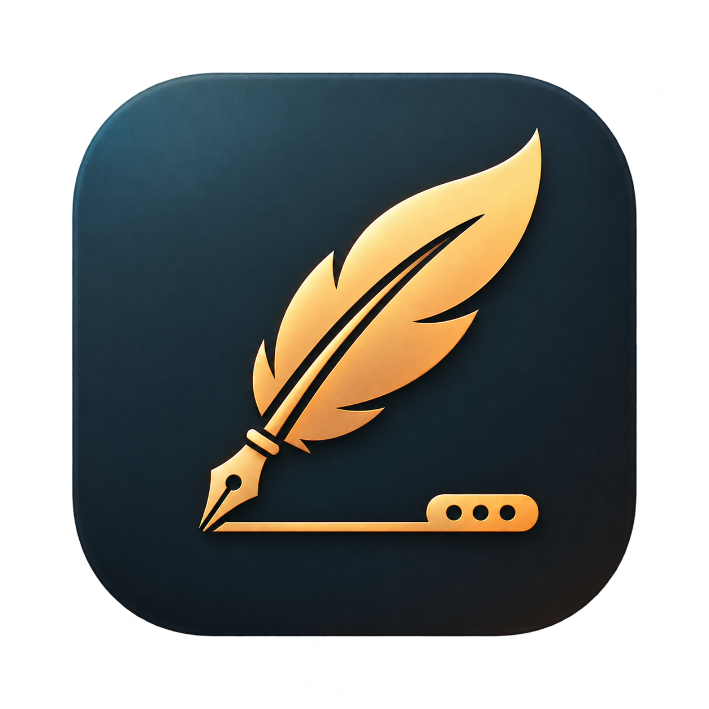

# Escriba

<p align="center"></p>

Biblioteca de notas de voz para macOS 26, Linux y Windows 11: graba o importa
audio, transcribe localmente y publica mediante recetas y conectores TypeScript.
En macOS usa WhisperKit y Apple Intelligence; en Linux y Windows usa whisper.cpp
y los resolutores LLM que configure el usuario. También admite resolutores compatibles con OpenAI y carpetas vigiladas
de Just Press Record, Notas de Voz o cualquier colección de audio.

La aplicación de escritorio utiliza **Tauri, TypeScript y Rust**, con
**SurrealDB embebida** para datos y trabajos duraderos. Swift adapta las APIs
nativas de Apple. Se distribuye una sola aplicación: **Escriba.app**.

## Empezar

Requiere macOS 26 y un Mac con Apple Silicon (M1 o posterior). Para instalar la
versión publicada, descarga el ZIP de macOS desde la
[release oficial](https://github.com/Zetesis-Labs/escriba/releases), descomprímelo
y arrastra `Escriba.app` a Aplicaciones. Después, abre la app. Si macOS bloquea
la apertura, ve a **Ajustes del Sistema > Privacidad y seguridad > Abrir
igualmente** y confirma que quieres abrir Escriba. Consulta también las
[instrucciones de Apple](https://support.apple.com/es-es/102445).

Los ZIP cuyo nombre termina en `_sin-notarizar.zip` llevan firma ad hoc y
requieren la autorización manual anterior. Los que terminan en `_macos_arm64.zip`
están firmados con Developer ID y notarizados por Apple. El ZIP incluye
`LEEME.txt` con los pasos de su modalidad. La release ofrece también
`SHA256SUMS-macos-arm64` para comprobar el checksum del ZIP. El
flujo para activar la notarización cuando estén configurados los certificados
está documentado en [releases de macOS](docs/releases-macos.md); todavía no se
ha probado una notarización real.

También puedes compilar e instalar desde el código fuente:

```sh
./scripts/build-app.sh --release
./scripts/install-app.sh --release
```

Se instala como **Escriba.app**. La biblioteca y la configuración existentes se
conservan al actualizar. La app mantiene los trabajos
al cerrar la ventana y recupera el procesamiento interrumpido tras reiniciar.

- [Aplicación, requisitos, funciones y validación](apps/tauri/README.md)
- [Versión para Windows: motores, instalación y pruebas](docs/windows.md)
- [Persistencia SurrealDB](docs/tauri-persistence.md)
- [Runtime TypeScript aislado y paquetes npm](apps/tauri/runtime-host/README.md)
- [Protocolo del adaptador Apple](docs/tauri-native-protocol.md)
- [Decisión de migración](docs/adr/0003-migracion-tauri-surrealdb.md)
- [Identidad única de la aplicación](docs/adr/0005-escriba-unica-app.md)

Los conectores Notion y OKF viven en `packages/conectores`. Las recetas se editan en una carpeta elegida por el usuario y se
construyen con el Bun incluido en Escriba. El playground CodeMirror incorpora
instalación de dependencias, comprobación de tipos con TypeScript 7 y pruebas;
la app carga el `dist/` resultante. Véase [proyectos de recetas](docs/proyecto-recetas-tauri.md).
El proyecto también puede declarar proveedores con formularios y acciones que
aparecen en Conectores, y usar SDK mediante `escriba.cuenta(...).fetch`. Los
secretos y el audio se manejan mediante capacidades nativas; las recetas no
reciben los tokens. El [ejemplo de proveedor](examples/conectores/README.md)
muestra el contrato sin añadir código específico a la aplicación.

## Desarrollo

```sh
./scripts/build-app.sh --dev
npm test --prefix apps/tauri
cargo test --manifest-path apps/tauri/src-tauri/Cargo.toml --lib
```

El adaptador nativo y el CLI mantienen sus suites Swift (`swift test`, solo macOS).
La aplicación macOS se compila con el SDK de Apple, fuera del devcontainer de
otros proyectos. Las instrucciones completas están en [CLAUDE.md](CLAUDE.md).

Licencia MIT.
